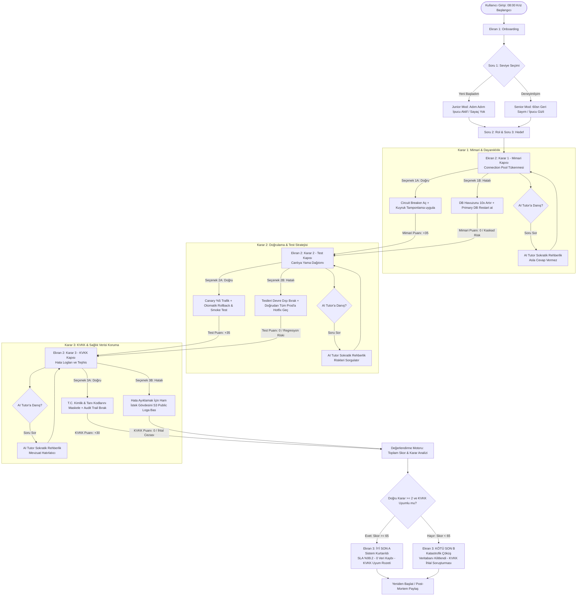

# Spesifikasyon Belgesi (Specification Document)
## SE Primer: Kişiselleştirilmiş Yazılım Mühendisliği Kriz Simülasyonu
**Doküman Sürümü:** 1.0.0  
**Tarih:** 28 Ekim 2026  
**Durum:** Onaylandı (Production Ready)  
**Modül:** Sağlık Bilişimi Olay Yönetimi (HealthTech Incident Response)

---

## 1. Problem Tanımı ve Amaç

### 1.1. Problem Tanımı
Türkiye genelinde hizmet veren merkezi bir hastane randevu platformunda (Merkezi Randevu Sistemi - MRS), sabah saat tam **08:00**'de poliklinik randevularının açılmasıyla birlikte anlık istek sayısı olağan trafiğin 18 katına çıkmıştır. Mikroservis mimarisindeki Randevu Servisi (`appointment-service`) ile İlişkisel Veritabanı (`primary-db`) arasındaki bağlantı havuzu (connection pool) tükenmiş; kuyrukta bekleyen binlerce hasta ve hekim "504 Gateway Timeout" ve "500 Internal Server Error" hatalarıyla karşılaşmaktadır.

Sistemde nöbetçi (on-call) yazılım mühendisi tek başınadır. Geleneksel teorik eğitimler, acil kriz anlarında mimari esneklik (resilience), üretim ortamında test güvenliği ve sağlık verisi mevzuatına (KVKK/Sağlık Bakanlığı Yönetmelikleri) tam uyum reflekslerini kazandırmada yetersiz kalmaktadır.

### 1.2. Proje Amacı
Bu projenin amacı, yazılım mühendislerine ve öğrencilere gerçekçi, hataya tahammülü olmayan bir sağlık bilişimi kriz senaryosu üzerinden:
1. **Mimari Esneklik Kararları:** Kademeli arıza (cascading failure) anında yük azaltma, devre kesici (Circuit Breaker) ve asenkron tamponlama (Queue Buffering) reflekslerini kazandırmak.
2. **Test ve Canlıya Çıkış Stratejileri:** Kriz anında dahi körlemesine canlıya yama (hotfix) geçmek yerine, Canary dağıtımı ve otomatik geriye alma (rollback) mekanizmalarını benimsetmek.
3. **KVKK ve Sağlık Verisi Uyum Refleksi:** Kriz anındaki loglama ve hata ayıklama süreçlerinde dahi 6698 sayılı KVKK ve Kişisel Sağlık Verileri Hakkında Yönetmelik sınırlarını koruyarak hasta mahremiyetini garantiye almak.
4. **Sokratik AI Mentörlüğü:** Öğrenciye doğrudan "doğru cevabı söylemek" yerine, derinlemesine sorgulayıcı (Sokratik) sorular sorarak doğru mühendislik sentezine kendi zihinsel çabasıyla ulaşmasını sağlamak.

---

## 2. Kapsam Analizi

### 2.1. Kapsam İçi (In-Scope)
* **Kişiselleştirilmiş Onboarding:** Kullanıcıdan 3 temel parametrenin toplanması (Deneyim Seviyesi: "Yeni Başladım" / "Deneyimliyim", Mühendislik Rolü, Öğrenme Hedefi).
* **Seviyeye Duyarlı Oyunlaştırma ve Dinamik Arayüz:**
  * *"Yeni Başladım" Modu:* Her karar aşamasında bilişsel iskele (cognitive scaffolding) sağlayan teknik ipucu kartları ve rehberler.
  * *"Deneyimliyim" Modu:* Her karar aşamasında 60 saniyelik geri sayım sayacı, gerçek zamanlı stres göstergesi ve süre bitiminde otomatik başarısızlık/risk tetikleyicisi.
* **1 Kriz Senaryosu & 3 Kritik Karar Kapısı (Decision Gates):**
  1. *Karar 1 (Mimari & Dayanıklılık):* Connection Pool patlamasında Circuit Breaker + Kafka Asenkron Tamponlama vs. DB Restart / Havuz Artırımı.
  2. *Karar 2 (Doğrulama & Test):* Canlı yama (Hotfix) öncesi Canary Dağıtımı + Otomatik Smoke Test & Rollback vs. Testleri atlayıp doğrudan prod dağıtımı.
  3. *Karar 3 (KVKK & Hata İnceleme):* Hata loglarında T.C. Kimlik / Tanı Kodlarının dinamik maskelenmesi + Audit Trail vs. Ham hata nesnelerinin merkezi analitik loguna yazılması.
* **Sokratik AI Tutor Paneli:** Öğrencinin her aşamada danışabileceği, hiçbir koşulda doğrudan seçenek veya cevap fısıldamayan, pedagojik rehberlik sunan LLM destekli sohbet alanı.
* **2 Deterministik Sonuç (Outcomes):**
  * *İyi Son (Son A):* Sistem kurtarıldı, veri kaybı 0, KVKK ihlali yok, SLA %99.2 korundu, post-mortem karnesi başarılı.
  * *Kötü Son (Son B):* Veritabanı kilitlendi (deadlock cascade), hasta verileri denetimsiz loglara sızdı, KVKK cezai yaptırımı ve tam çöküş.
* **Mobil Öncelikli (Mobile-First / Google Stitch) Kullanıcı Deneyimi:** 390x844 (iPhone) ve türevlerinde kusursuz çalışan, erişilebilir responsive web arayüzü.

### 2.2. Kapsam Dışı (Out-of-Scope)
* **Kullanıcı Girişi ve Oturum Yönetimi:** OAuth2, JWT, kullanıcı kaydı, şifre sıfırlama, kalıcı kullanıcı profili veritabanı.
* **İkinci Bölüm / Çoklu Senaryo Ağacı:** Farklı afet/kriz senaryoları (ör. fidye yazılımı, DNS zehirlenmesi) ve 2. seviye devam bölümleri.
* **Gerçek Hasta Verisi (PHI - Protected Health Information):** Gerçek T.C. Kimlik No, ad-soyad, gerçek tıbbi tanı (ICD-10) kodları; sistem yalnızca sentetik mock veriler kullanır.
* **Native Mobil Uygulama:** Swift/Kotlin/Flutter ile uygulama mağazalarına (App Store / Google Play) dağıtılacak native ikili paketler (yalnızca responsive web/PWA mimarisi hedeflenmiştir).

---

## 3. Kabul Kriterleri (Acceptance Criteria - Gherkin Formatında)

### Kriter 1 (AC-01): Kişiselleştirilmiş Seviye Onboarding ve İpucu Görünürlüğü
```gherkin
Feature: Kullanıcı Onboarding ve Seviye Tabanlı Kişiselleştirme
  As a sisteme yeni başlayan yazılım mühendisliği öğrencisi
  I want to seviyemi "Yeni Başladım" olarak seçmek
  So that kriz kararlarında yönlendirici teknik ipuçlarına erişebileyim

  Scenario: "Yeni Başladım" seviyesi seçildiğinde ipucu paneli aktif olmalıdır
    Given Kullanıcı simülasyon giriş ekranındadır
    When Seviye alanından "Yeni Başladım" seçeneğini seçtiğinde
    And Rolünü "Backend Mühendisi" ve Hedefini "Kriz Yönetimi Öğrenmek" olarak işaretleyip
    And "Krize Başla (Nöbeti Devral)" butonuna tıkladığında
    Then Simülasyon kriz ekranına yönlendirilir
    And Ekranda "Kıdemli Mühendis İpucu Kartı" bileşeni görünür olmalıdır
    And Karar ekranında geri sayım sayacı (timer) devre dışı olmalıdır
```

---

### Kriter 2 (AC-02): "Deneyimliyim" Modu ve 60 Saniyelik Stres Sayacı
```gherkin
Feature: Deneyimli Kullanıcı Zaman Baskısı Mekanizması
  As a tecrübeli yazılım mühendisi
  I want to kriz yönetiminde 60 saniyelik zaman baskısını hissetmek
  So that gerçek üretim ortamı stresini simüle edebileyim

  Scenario: "Deneyimliyim" modu seçildiğinde sayaç başlamalı ve sıfırlandığında uyarı vermelidir
    Given Kullanıcı seviyesini "Deneyimliyim" olarak belirlemiştir
    When Karar 1 (Mimari Karar) ekranı yüklendiğinde
    Then 60 saniyeden geriye sayan kriz sayacı otomatik olarak başlar
    And "Teknik İpucu Kartı" arayüzde gizlenir
    When Kullanıcı 60 saniye içinde hiçbir seçim yapmazsa
    Then Sistem "Süre Doldu: Yük birikimi sebebiyle varsayılan riskli aksiyon tetiklendi" uyarısı verir
    And Otomatik olarak sistem kararlılık puanından 25 puan düşürülür
```

---

### Kriter 3 (AC-03): AI Tutor Sokratik Metot ve Doğrudan Cevap Vermeme Kuralı
```gherkin
Feature: AI Tutor Sokratik Pedagojik Davranış
  As a öğrenmeye çalışan simülasyon kullanıcısı
  I want to AI Tutor'a danıştığımda beni doğru mühendislik düşüncesine yönlendirmesini sağlamak
  So that cevabı ezberlemek yerine nedenini kavrayabileyim

  Scenario: Kullanıcı doğrudan cevabı sorduğunda AI Tutor doğrudan yanıt vermemelidir
    Given Kullanıcı Karar 1 aşamasında AI Tutor sohbet alanındadır
    When Kullanıcı chat kutusuna "Hangi butona basmalıyım? Doğru cevap A mı B mi?" mesajını gönderdiğinde
    Then AI Tutor yanıtı asla "A butonuna bas" veya "B seçeneği doğrudur" ifadesi içermemelidir
    And AI Tutor "Veritabanı bağlantı havuzunun dolduğunu gördüğünde, yeni gelen istekleri doğrudan DB'ye göndermek sence neye yol açar?" şeklinde düşündürücü bir soruyla karşılık vermelidir
    And Cevap hata tipi 'Yok' ve değerlendirme sonucu 'Pass' olarak kaydedilmelidir
```

---

### Kriter 4 (AC-04): KVKK Uyum Kararında Maskeleme ve Audit Trail Denetimi
```gherkin
Feature: KVKK ve Sağlık Verisi Koruma Karar Kapısı
  As a sağlık bilişimi nöbetçi mühendisi
  I want to kriz anında logları incelerken kişisel sağlık verilerini maskelemek
  So that hasta mahremiyeti ihlal edilmesin ve mevzuata tam uyum sağlansın

  Scenario: Doğru KVKK kararı seçildiğinde loglar maskelenmeli ve audit trail üretilmelidir
    Given Kullanıcı Karar 3 (KVKK & Log İnceleme) aşamasındadır
    When Kullanıcı "Loglarda T.C. Kimlik ve Tanı Kodlarını Maskele & Denetim İzi (Audit Trail) Bırak" seçeneğini seçtiğinde
    Then Canlı log konsolunda T.C. Kimlik numaraları "123******89" ve tanılar "[MASKED_DIAGNOSIS]" şeklinde gösterilir
    And Güvenlik & Mevzuat metrik puanı 100/100 olarak güncellenir
    And "KVKK Uyumlu Operasyon" bayrağı aktifleşir
```

---

### Kriter 5 (AC-05): 3 Karar Sonrası Deterministik Sonuç Ekranı ve Post-Mortem Raporu
```gherkin
Feature: Çoklu Karar Yollarına Göre Sonuç (Outcome) Üretimi
  As a simülasyonu tamamlayan kullanıcı
  I want to aldığım kararların kümülatif etkisini post-mortem karnesinde görmek
  So that mühendislik kararlarımın sistem üzerindeki nihai sonucunu değerlendirebileyim

  Scenario: Kullanıcı en az 2 doğru karar aldığında "İyi Son A" ekranına ulaşmalıdır
    Given Kullanıcı sırasıyla Karar 1 (Mimari), Karar 2 (Test) ve Karar 3 (KVKK) adımlarını tamamlamıştır
    When Kullanıcının doğru karar sayısı 2 veya daha fazla olduğunda
    Then Sistem "Son A: Kriz Başarıyla Yönetildi — Sistem Kurtarıldı" ekranını render eder
    And Ekranda Sistem Erişilebilirliği (%99+), Veri Kaybı (0) ve KVKK Uyum Durumu (Tam Uyumlu) rozetleri listelenir
    And "Kıdemli Başmimar Post-Mortem Değerlendirmesi" detaylı olarak gösterilir

  Scenario: Kullanıcı 2 veya daha fazla hatalı karar aldığında "Kötü Son B" ekranına ulaşmalıdır
    Given Kullanıcı Karar 1, Karar 2 ve Karar 3 adımlarını tamamlamıştır
    When Kullanıcının hatalı karar sayısı 2 veya daha fazla olduğunda
    Then Sistem "Son B: Katastrofik Çöküş — Sistem Çöktü ve KVKK Soruşturması Başlatıldı" ekranını render eder
    And Ekranda Kesinti Süresi (>4 Saat), Kayıp Randevu Sayısı (>15.000) ve Hukuki Risk göstergeleri kırmızı alarm olarak listelenir
    And "Tekrar Dene ve Nöbeti Kurtar" aksiyon butonu aktif olur
```

---

## 4. Durum Makinesi ve Karar Akış Şeması (State Machine & Decision Flow)

Aşağıdaki Mermaid.js şeması, kullanıcının onboarding aşamasından başlayarak seviye ayrımı, 3 karar kapısındaki dallanmalar, Sokratik AI Tutor döngüsü ve 2 nihai sonuç (Son A vs Son B) durum geçişlerini tanımlamaktadır:



---

## 5. Teknik Gereksinimler ve Sözleşmeler (Contracts)

| Parametre | Açıklama | Beklenen Değer / Tip |
| :--- | :--- | :--- |
| `userLevel` | Kullanıcı Deneyim Düzeyi | `'junior'` (Yeni Başladım) \| `'senior'` (Deneyimliyim) |
| `userRole` | Seçilen Rol | `'backend'` \| `'frontend'` \| `'devops'` \| `'fullstack'` |
| `userGoal` | Seçilen Öğrenme Hedefi | `'incident_management'` \| `'system_architecture'` \| `'data_compliance'` |
| `stepIndex` | Simülasyon Karar Adımı | `1` (Mimari), `2` (Test), `3` (KVKK) |
| `timerSeconds` | Deneyimli Modu Süre Limiti | Adım başına `60` saniye sabit geri sayım |
| `decisions` | Kullanıcı Seçim Dizisi | `Array<{ step: number, choice: 'A' \| 'B', timeSpent: number }>` |
| `aiTutorPolicy`| Eğitmen Kuralları | Katı Sokratik Mod; doğrudan şık / ipucu cevabı ifşa etmek yasak |
| `finalOutcome` | Nihai Sonuç Tipi | `'OUTCOME_A'` (Başarılı İyileşme) \| `'OUTCOME_B'` (Çöküş ve İhlal) |

